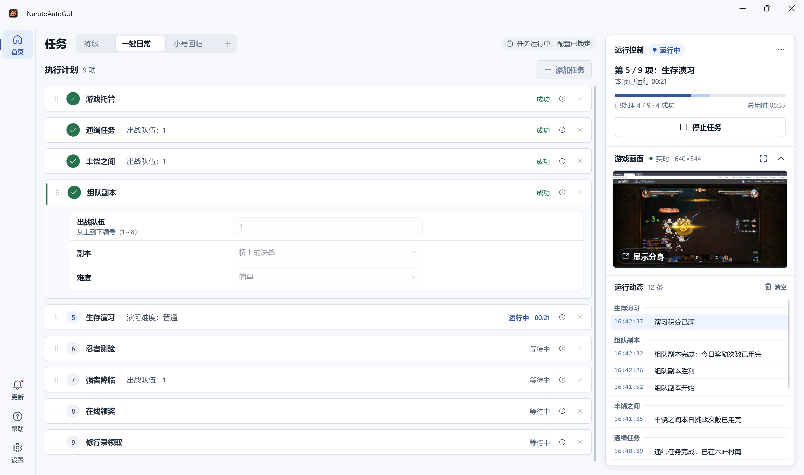

  

<h1 align="center">MaaNOP</h1>

  <strong>免费的《火影忍者 Online》自动化助手</strong>

  独立桌面后台挂机 · 无需调整分辨率和缩放 · 练小号与一键日常

  
  
  
  

  <a href="https://github.com/ArcherSore/MaaNOP/releases/latest"><strong>下载最新版</strong></a>
  ·
  <a href="https://www.bilibili.com/video/BV1VaJU65Ebm/">使用指南</a>
  ·
  <a href="https://github.com/ArcherSore/NarutoAutoGUI/blob/main/docs/USER-GUIDE.md">用户手册</a>
  ·
  <a href="https://github.com/ArcherSore/MaaNOP/issues">反馈问题</a>

---

## ✨ 核心亮点

- **独立桌面后台挂机**：在独立 Windows 桌面会话中运行游戏与脚本，不持续占用日常使用的鼠标、键盘和窗口焦点。
- **无需调整分辨率和缩放**：不必为了运行脚本手动修改 Windows 显示分辨率或缩放比例。
- **练小号与一键日常**：支持批量练小号、领取资源，木叶购物节还能自动送字，不用再找字商买字。主号也可以一键完成日常任务，省时省心。

## 🖥️ 软件预览

  

  <a href="https://www.bilibili.com/video/BV1V8JU61E4q/">🎬 一键日常演示</a>
  ·
  <a href="https://www.bilibili.com/video/BV1VaJU65Ebm/">📖 新手使用指南</a>

## 🚀 开始使用

首次使用请先阅读[用户使用手册](https://github.com/ArcherSore/NarutoAutoGUI/blob/main/docs/USER-GUIDE.md)，按步骤保存 Windows 分身登录密码、配置 QQ 大厅自动登录，再开始任务。

从 [Releases](https://github.com/ArcherSore/MaaNOP/releases/latest) 下载 **`MaaNOP-win-x86_64-*.zip`**，完整解压后运行 `NarutoAutoGUI.exe`。按界面提示准备桌面分身、登录游戏、选择任务，即可开始自动化。

> [!IMPORTANT]
> - 支持 **Windows 10/11 x64**，需要管理员权限。
> - 仅支持《火影忍者 Online》**QQ 游戏大厅**客户端，不支持官方微端、360 游戏大厅等其他客户端。
> - 挂机期间可以隐藏桌面分身，但电脑不能进入睡眠或休眠。

## ❓ 帮助与反馈

使用中遇到问题，可以先查看软件内的 **「帮助」** 页面，或观看 [新手使用指南](https://www.bilibili.com/video/BV1VaJU65Ebm/)。

如果遇到 Bug，欢迎通过以下方式反馈：

- **[GitHub Issues](https://github.com/ArcherSore/MaaNOP/issues)**：推荐提交 Bug 和功能建议，方便跟踪和处理。
- **个人 QQ：368655734**：也可以直接联系我，添加好友时请备注「MaaNOP」。

反馈问题时，请简单描述遇到的情况，并在软件的 **「帮助」→「导出诊断包」** 中导出日志，一并发送，方便定位问题。

> 提交诊断包前，请检查其中是否包含账号等个人敏感信息。

## ❤️ 支持与鸣谢

如果 MaaNOP 对你有帮助，欢迎 [在爱发电支持项目](https://afdian.com/a/archersore)，或者为仓库点个 Star ⭐。

感谢 [MaaFramework](https://github.com/MaaXYZ/MaaFramework)、[NarutoAutoGUI](https://github.com/ArcherSore/NarutoAutoGUI) 和 [BetterGI](https://github.com/babalae/better-genshin-impact) 等开源项目提供的基础与参考。

## 📄 许可与免责声明

本项目采用 [GPL-3.0](LICENSE) 许可证。第三方组件的许可信息请参阅 [THIRD_PARTY_NOTICES.md](THIRD_PARTY_NOTICES.md)。

MaaNOP 为社区维护的开源自动化项目，与《火影忍者 Online》及其运营方无官方关联。请自行了解并遵守游戏服务条款及相关规定，使用自动化工具的风险由使用者自行承担。
