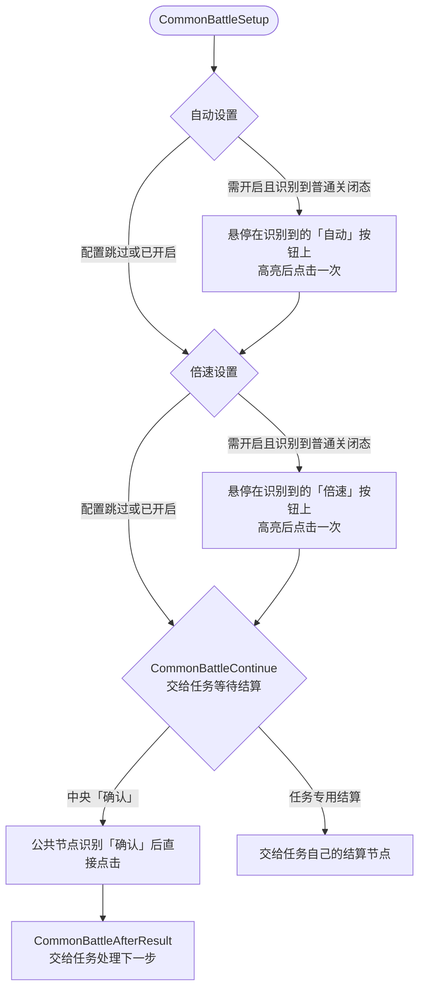

# 公共战斗流程图

下图为公共战斗默认设置流程。押镖复用自动设置，跳过倍速。

自动和倍速由调用任务分别配置，默认都开启。已进入战斗的任务接入 `CommonBattleSetup`。需要先点「开战」的任务绑定 `CommonBattleStartTarget`，再调用 `CommonBattleClickStart`，点击后进入同一个设置流程。 [公共战斗流水线](../../../assets/resource/pipeline/common/AutoBattle.json)

| 任务配置 | 关闭时的锚点绑定 | 默认 |
| --- | --- | --- |
| 自动 | `"CommonBattleSkipAuto": "CommonBattleSetupSpeed"` | 开启 |
| 倍速 | `"CommonBattleSkipSpeed": "CommonBattleFinishSetup"` | 开启 |

两项可以分别关闭，也可以同时关闭。同一任务切换配置时，用空字符串清除不再需要的绑定。`CommonBattleContinue` 指向任务的结算等待节点。

设置期间优先处理已经出现的结算或业务中断，包括等待按钮高亮时。`CommonBattleOutcome` 和 `CommonBattleInterrupt` 由调用方绑定。使用中央「确认」的任务通过 `CommonBattleAfterResult` 指定点完之后的节点。
