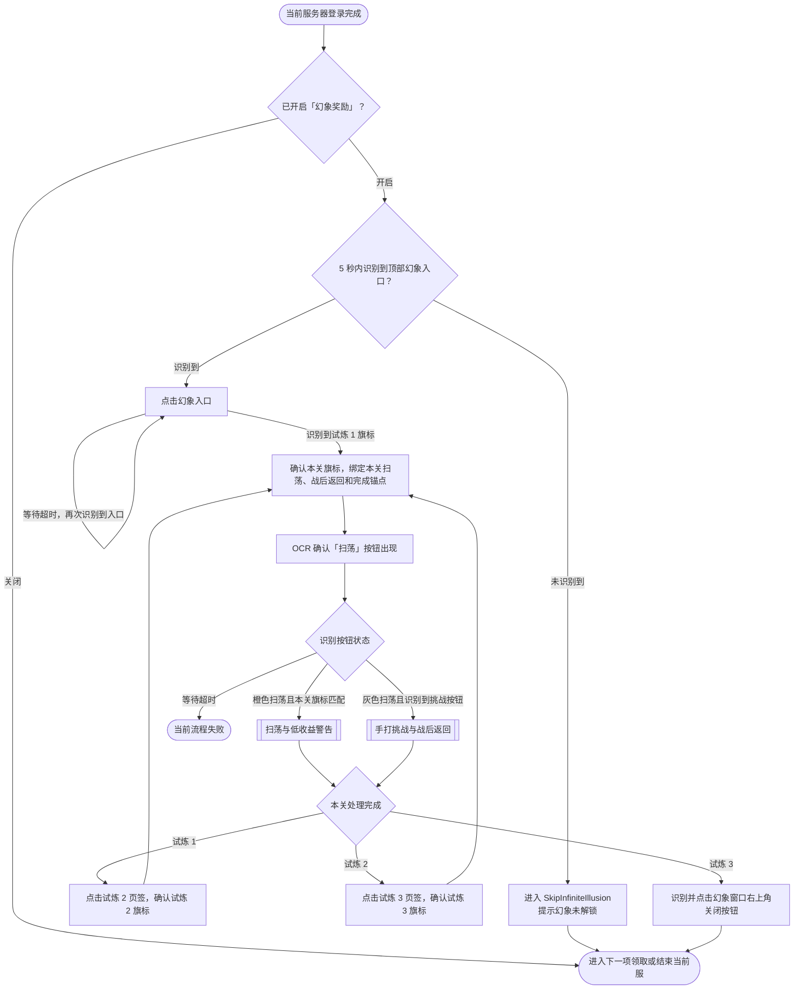
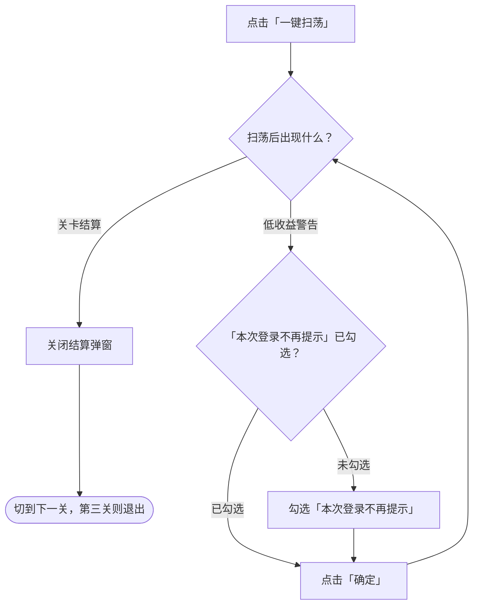
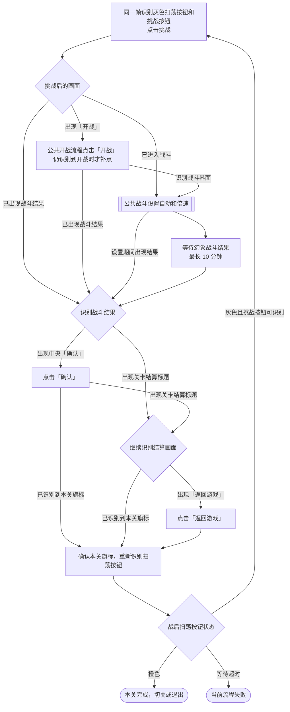

# 幻象试炼流程图

小号批量领取中的「幻象奖励」默认开启。下图从当前服务器登录完成后画起。 [任务流水线](../../../assets/resource/pipeline/alt_accounts/ClaimInfiniteIllusion.json) · [公共战斗流程](公共战斗.md)

## 主流程

进入后按试炼 1、2、3 的顺序处理。切关等待超时时，现有 `on_error` 会重新识别对应页签，命中后再次点击。

## 扫荡与低收益警告

## 手打挑战与战后返回

战后扫荡按钮变橙色时，通过本关完成锚点切关或退出。
