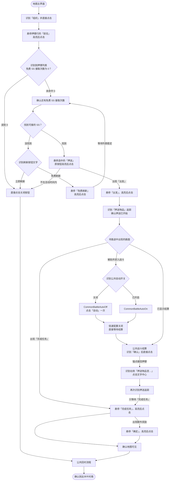

# 押镖流程图

日常任务从地图主界面进入，每轮最多接取一条免费 SS 级押镖。 [任务流水线](../../../assets/resource/pipeline/routine/Escort.json)

必需的识别或动作失败时，任务结束为失败。 [公共战斗流程](公共战斗.md) · [公共回村流水线](../../../assets/resource/pipeline/common/ReturnToVillage.json)

## 真机验证

2026-11-07，用户在 Windows 客户端完整跑通原有押镖流程。被劫分支使用实拍截图离线回放，待真机验证。
