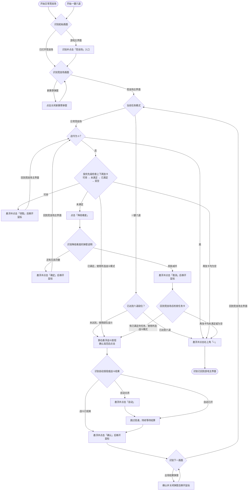

# 普通竞技场流程图

两个模式共用进场、开战、托管和结算。每次结算回到竞技场主界面后，重新检查各自的停止条件。

[普通竞技场共用流水线与一键六道入口](../../../assets/resource/pipeline/arena/Arena.json) · [日常竞技场流水线](../../../assets/resource/pipeline/arena/DailyArena.json)

