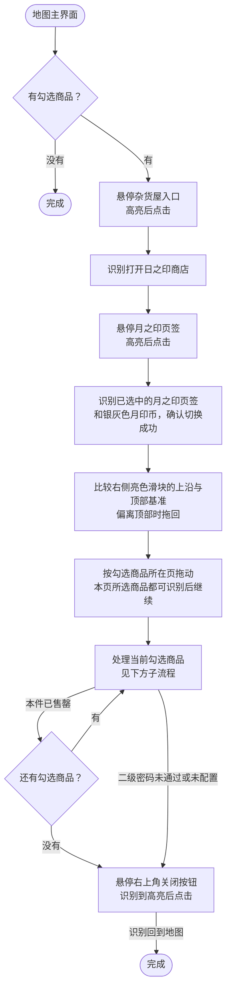
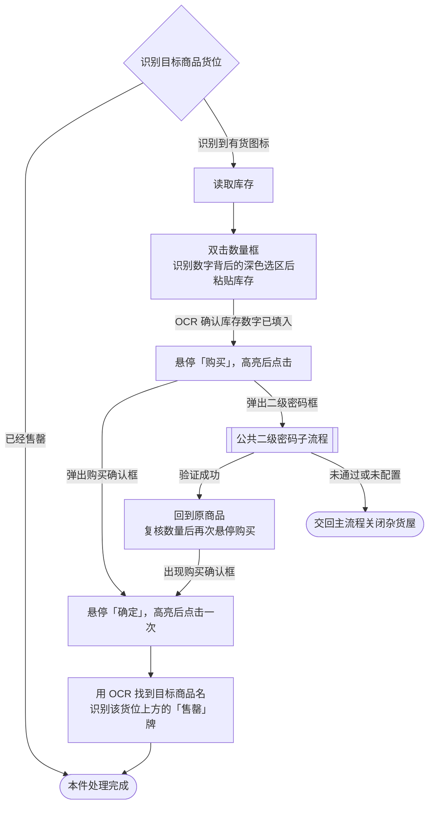

# 杂货铺流程图

[任务流水线](../../../assets/resource/pipeline/routine/general_store/GeneralStore.json) · [商品与结算代码](../../../agent/routine/general_store/action_general_store.py) · [公共二级密码流程](公共二级密码.md)

## 主流程

## 购买一件商品

