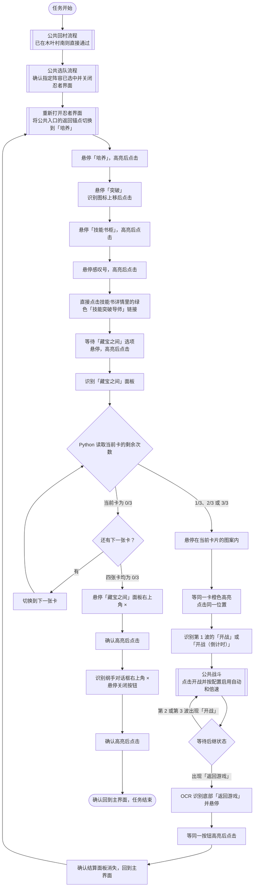

# 藏宝之间流程图

任务分组为「日常」（`Routine`）。「出战队伍」从上到下编号 1～8，默认选 1 号。

[任务流水线](../../../assets/resource/pipeline/routine/TreasureRoom.json) · [任务选项](../../../assets/interface.json) · [公共回村流水线](../../../assets/resource/pipeline/common/ReturnToVillage.json) · [公共选队流程](../../../assets/resource/pipeline/common/SelectTeam.json) · [公共战斗流程](公共战斗.md) · [组队副本流水线](../../../assets/resource/pipeline/routine/TeamDungeon.json)

## 主流程

