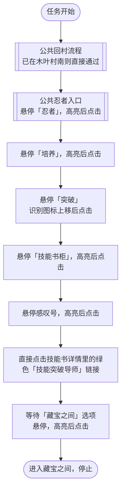

# 藏宝之间流程图

任务分组为「日常」（`Routine`）。

[任务流水线](../../../assets/resource/pipeline/routine/TreasureRoom.json) · [公共回村流水线](../../../assets/resource/pipeline/common/ReturnToVillage.json) · [公共忍者入口](../../../assets/resource/pipeline/common/Entry.json)

## 主流程

