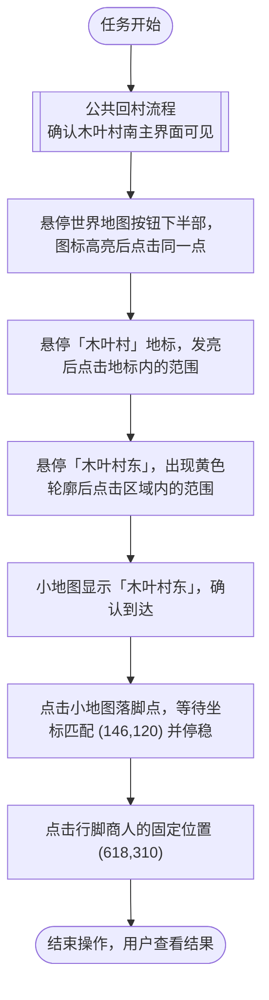

# 行脚商人流程图

所属分组为「体力药水」（蹲体力）。[行脚商人入口](../../../assets/resource/pipeline/routine/WanderingMerchant.json) · [公共回村流水线](../../../assets/resource/pipeline/common/ReturnToVillage.json) · [公共地图导航](../../../assets/resource/pipeline/common/MapNavigation.json)

## 前往木叶村东并点击商人

