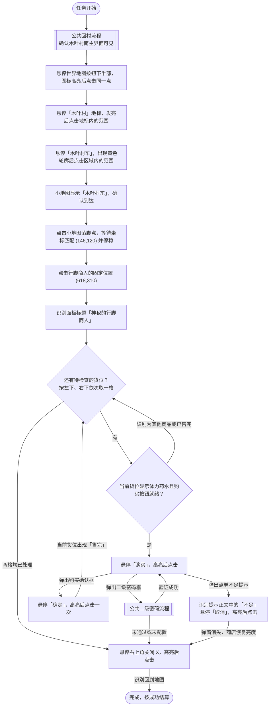

# 行脚商人流程图

流水线：[WanderingMerchant.json](../../../assets/resource/pipeline/routine/WanderingMerchant.json)。

[公共回村流水线](../../../assets/resource/pipeline/common/ReturnToVillage.json) · [公共地图导航](../../../assets/resource/pipeline/common/MapNavigation.json) · [公共商人购买流水线](../../../assets/resource/pipeline/common/MerchantPurchase.json) · [公共二级密码流程](公共二级密码.md)

## 主流程

