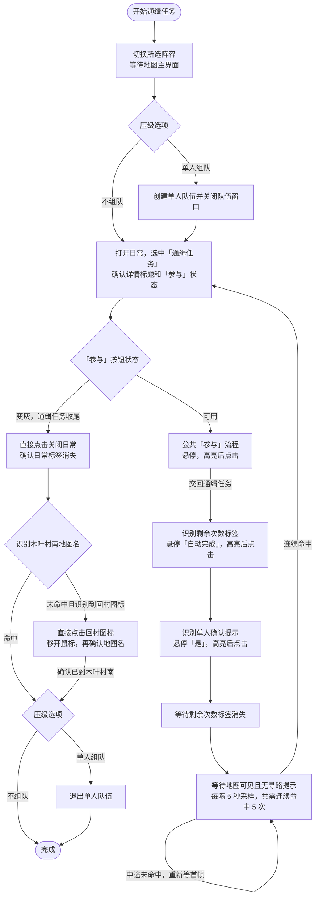
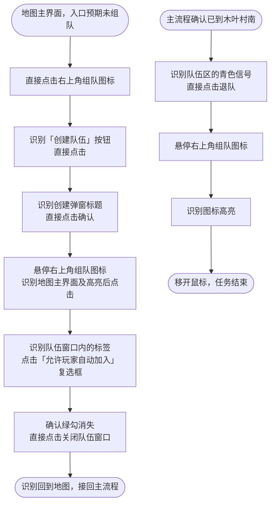

# 通缉任务流程图

启用「压级 → 单人组队」时，先建立单人队伍，确认回到木叶村南后再退队。自动通缉过程中一旦连续采到五次闲置画面，重新打开日常检查「参与」按钮。

[通缉任务流水线](../../../assets/resource/pipeline/routine/Wanted.json) · [任务选项](../../../assets/interface.json) · [公共日常流水线](../../../assets/resource/pipeline/common/DailyTask.json)

## 主流程

## 单人组队与退队

