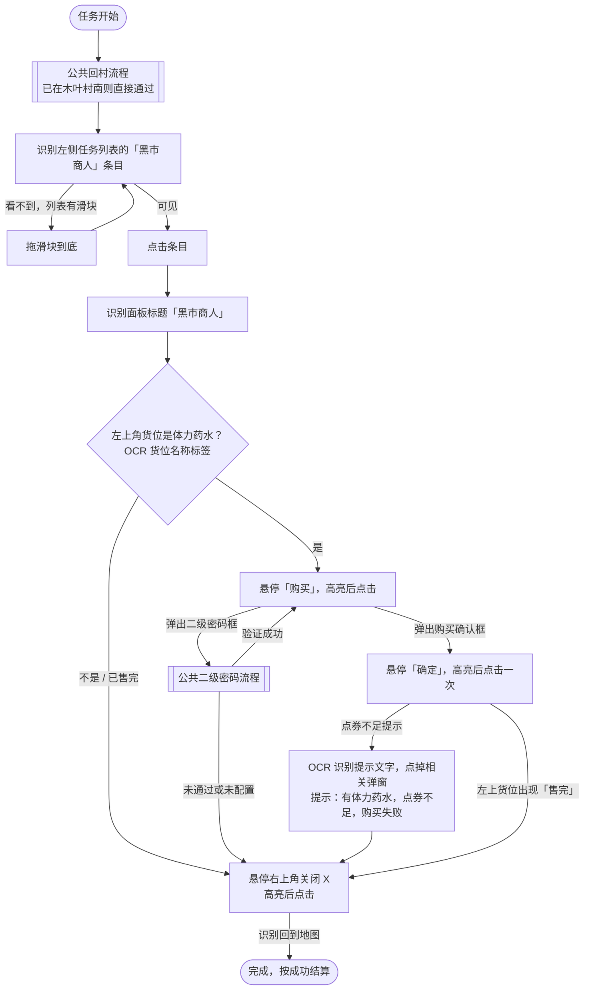

# 黑市商人流程图

购买黑市商人左上角货位的体力药水（需点券）。流水线：[BlackMarket.json](../../../assets/resource/pipeline/routine/BlackMarket.json)。

[公共回村流水线](../../../assets/resource/pipeline/common/ReturnToVillage.json) · [公共二级密码流程](公共二级密码.md) · [杂货铺流程](杂货铺.md)

## 主流程

